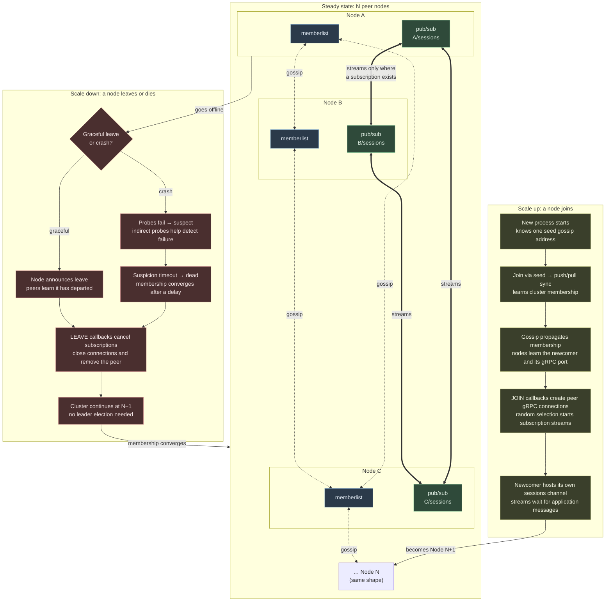

# rhizome

A loopback-only Go proof of concept: each process discovers peers through
HashiCorp memberlist, hosts a gRPC `sessions` channel, and
randomly subscribes to other nodes. No central broker or Publish RPC is involved.

## Setup

Install Go 1.22 or newer, then from this directory:

```sh
go mod download
go build .
go vet ./...
go test -race ./...
```

Generated protobuf Go files are included, so running/building needs no `protoc`.
To regenerate them, install the protobuf compiler (for example,
`brew install protobuf` on macOS or `sudo apt-get install protobuf-compiler`
on Debian/Ubuntu), then run:

```sh
make proto
```

The Makefile installs pinned `protoc-gen-go` and `protoc-gen-go-grpc` versions
into the ignored `.bin/` directory. You can override the compiler path with
`make proto PROTOC=/path/to/protoc`.
See the [gRPC Go code generation guide](https://grpc.io/docs/languages/go/quickstart/).

## Run three nodes

In three separate terminals, in this directory:

```sh
go run . -gossip 7946 -grpc 9000
```

```sh
go run . -gossip 7947 -grpc 9001 -join 127.0.0.1:7946
```

```sh
go run . -gossip 7948 -grpc 9002 -join 127.0.0.1:7946
```

Both listeners bind to `127.0.0.1`. Each gossip port uses TCP and UDP; each
gRPC port uses TCP. Ports must be unused and distinct. Names default to
`node-<gossipPort>`; use `-name alice` to override, keeping names unique.
`-join` is a gossip address, not a gRPC address. It is only needed to bootstrap
membership; the first node has no special ongoing role. Run `go run . -h` for flags.

Expect prefixed `JOIN` and `READY` logs. After an initial randomized 10–20
seconds, each node independently chooses each known peer with probability 0.5,
repeating every 10–20 seconds. `SUBSCRIBE` and `UNSUBSCRIBE` show these decisions.
A node can choose zero peers, and subscriptions need not be reciprocal.

There is no automatic message generation or command-line publishing input.
Subscription streams remain idle until application code calls the local server's
`publish` method. The fan-out implementation remains available for that use.

Messages are live only: there is no replay, persistence, acknowledgement, or
delivery guarantee. Each incoming subscription has a 32-message queue. A full
queue drops new messages for that subscriber and logs `WARN DROP`; other
subscribers continue receiving. A stream error is logged and clears that
subscription; a later randomized selection may start another. gRPC handles
connection management, but there is no custom retry loop. `UPDATE` logs
membership metadata updates and replaces a connection if its advertised port
changes. Normal runs need not produce UPDATE events.

## Scaling up and down

Every node has the same role; there is no master or leader election. Gossip
maintains membership, while gRPC carries messages directly from publishers to
subscribers. The stream links below illustrate possible subscriptions, not
mandatory or reciprocal connections. Each node chooses each peer independently
with probability 0.5 every 10–20 seconds.



A crashed node's streams may report errors before gossip declares it dead. Its
messages are not transferred to another node: each process owns only its own
`sessions` channel.
Adding nodes increases connections and expected subscription traffic; this demo
does not partition channels or automatically balance load.

## Stopping nodes

Ctrl-C (SIGINT) or SIGTERM cancels work, announces memberlist Leave, shuts down
gossip, cancels outbound streams and closes peer connections, and gracefully
stops gRPC. Incoming handlers also observe shutdown; a three-second fallback
forces gRPC to stop if a transport cannot drain. Peers log `LEAVE` and remove
the departing node and its subscription.

`kill -9` prevents cleanup and sends no leave announcement. Peers can first
log a stream error, then detect the missing node through gossip failure
detection and log `LEAVE` after a delay. The rest of the cluster continues.
When testing signals by PID, build and run `./rhizome` directly so you target
the node process rather than the `go run` wrapper.

This demo uses insecure gRPC credentials and trusts local peers. It is intended
for several processes on one laptop, not deployment over a network.
