# Rhizome

**Connect coding agents across terminals, worktrees, and colleagues' machines.**



Rhizome lets Claude Code, Codex, and OpenCode sessions discover each
other, follow selected work, and exchange messages through MCP. Use it to
coordinate parallel tasks on your laptop or connect your agents with a
colleague's agents over a LAN or Tailscale network.

Your agents keep working in their own projects and tools. Rhizome supplies the
communication infrastructure: verified session identities, peer discovery,
activity delivery, and explicit trust between machines.

[Quickstart](#quickstart) · [Collaborate with colleagues](#collaborate-with-colleagues) ·
[How it works](#how-it-works) · [Documentation](#documentation)

## What Rhizome enables

| Workflow | What you can do |
| --- | --- |
| **Parallel development** | Run implementation, tests, and review in separate sessions or worktrees. Follow relevant sessions so discoveries and blockers reach the agents that need them. |
| **Collaboration with colleagues** | Pair two machines, discover each other's agent sessions, and exchange context while each person keeps their own development environment. |
| **Cross-agent work** | Let a Codex session follow a Claude Code session or send a question to an OpenCode session. Supported integrations share the same session addressing and collaboration tools. |
| **Continuity across sessions** | Search past Claude Code, Codex, and OpenCode work and read selected activity through the optional local history service. A colleague can separately opt in to sharing history. |
| **Explicit file handoffs** | Offer a selected file to a session on a paired host. The recipient chooses whether to accept it into a temporary inbox. |

For example, you can work on an API in Codex while a colleague builds its client
in Claude Code. After pairing your machines, ask the client session to follow
the API session. It can receive updates as the API work progresses and send a
question back to that exact session. You still choose task ownership, repository
access, branches, and how changes are reviewed and merged.

## Quickstart

### 1. Install

Download a build from [GitHub Releases](https://github.com/aliengiraffe/rhizome/releases).
macOS has a signed and notarized installer that places `rhizome` in
`/usr/local/bin`. Archives are also available for macOS, Linux, and Windows;
Linux and Windows artifacts are unsigned. See the
[installation and checksum guide](docs/releasing.md#installing-and-upgrading).

Or build from source with Go 1.27.3+ and [Task v3](https://taskfile.dev/docs/installation):

```sh
git clone https://github.com/aliengiraffe/rhizome.git
cd rhizome
task build
./rhizome --version
```

The commands below assume `rhizome` is on your `PATH`. For a source build, use
`./rhizome` from the checkout and keep the binary there: setup registers its
absolute path.

### 2. Connect your agents

```sh
rhizome setup
```

Select your agents and review the setup changes. For a first local trial, keep
MCP networking **local** and gateway pairing **off**. Setup installs the
collaboration skill and, for Claude Code and Codex, their MCP registration
and binding hooks at user scope. OpenCode gets the skill and plugins; add its
[MCP entry manually](docs/opencode.md#install).

Restart your agent and complete its integration steps:

| Agent | Before the first conversation |
| --- | --- |
| **Claude Code** | Launch with `claude --dangerously-load-development-channels server:rhizome` and accept the channel/hook prompts. [Setup details](docs/reference.md#claude-setup). |
| **Codex** | Start a fresh session, review and trust the Rhizome hooks in `/hooks`. [Setup details](docs/codex.md#install). |
| **OpenCode** | Load the MCP entry and installed plugins, then submit a human prompt. [Setup details](docs/opencode.md#install). |

### 3. Try two sessions

Open two supported agent sessions and submit a prompt in each so they bind to
Rhizome. In one, invoke the installed skill with a task description:

```text
/rhizome-collab I'm implementing the API. Show me the other sessions and
help me identify which one is working on the client.
```

Then ask it to follow the relevant session or send a specific message:

```text
Subscribe to the client session we identified and send it this update:
"The response will include a next_cursor field; please account for pagination."
```

The agent uses `list_sessions`, `subscribe`, and `send` with exact session IDs.
Names help you recognize sessions; they never decide where a message goes.
Two sessions in the same directory remain separate.

## Collaborate with colleagues

**Host pairing connects two machines without sharing their local cluster tokens.**
Each person runs a Rhizome service, then explicitly pairs with the other host.
Both machines need compatible builds and network access to each other over a
LAN or an existing Tailscale network.

### 1. Enable pairing on both machines

For Tailscale, run on each machine:

```sh
rhizome setup --network local --gateway-mode tailscale --replace-config
rhizome service install
rhizome service stop
rhizome service start
```

`setup` saves the configuration and backs up an existing file. Installation
starts the service; stopping and starting applies changed settings to an existing service.
Restart your agents' MCP processes too. For a LAN, use `--gateway-mode lan`;
see the [pairing guide](docs/gateway.md#configure-and-run) for explicit addresses
and connectivity requirements. Tailscale must already be running on both hosts.

### 2. Invite your colleague

On your machine:

```sh
rhizome invite --expires 10m
```

Share the printed `rhizome join rhz1_...` command privately. Your colleague runs
it on their machine. Then check the connection:

```sh
rhizome peers list
```

### 3. Coordinate the work

Ask your agent to list sessions on the paired host, identify the relevant task,
and subscribe or send a message to its exact session ID. For example:

```text
My colleague is working on the client on the paired host. List its sessions
and help me find the client task, then follow that session's updates.
```

Pairing authenticates a **host**, not a person's identity. The same mechanism
also connects two machines you own. Remote origin is established by authenticated
host metadata, never inferred from a session name or project path.

**Sharing scope:** paired hosts currently see all eligible bound local sessions;
per-session privacy is not implemented. History sharing is off by default and
requires a separate [owner-controlled policy](docs/history.md#paired-host-history-opt-in).
Pairing is direct: pairing A with B and B with C does not connect A with C.
Use `rhizome peers revoke <host-id>` to revoke a host.

## How it works

Rhizome is a Go executable with two main roles: an MCP bridge for agent sessions,
and an optional per-user background service for observation, history, and host
pairing. Local messaging works without the background service. Cross-host pairing
requires the service on both machines.



| Layer | What it provides |
| --- | --- |
| **Session identity** | Agent-specific hooks or verified transport metadata bind each session. Exact IDs keep worktrees, concurrent chats, and agent types distinct. |
| **Local discovery and routing** | A private registry bootstraps memberlist discovery. Nodes exchange activity through authenticated gRPC on loopback; local peers can communicate directly. |
| **Agent integration** | Claude receives channel notifications, Codex uses its local queue, and OpenCode uses a private plugin bridge. |
| **Background service** | Observes supported local logs independently of open MCP sessions and maintains a metadata-first history catalog. Observation-only sessions cannot receive messages. |
| **Paired-host gateway** | Persistent host keys and invitations establish a direct TLS connection. Each service exposes remote sessions locally through proxies, keeping local tokens on their own machines. |

Rhizome needs no central broker or hosted coordination service. For paired hosts,
MCP networking stays local and the services handle cross-machine transport.
An alternative [shared-token LAN/Tailscale mode](docs/reference.md#lan-mode)
connects MCP nodes directly; it is a separate trust model and cannot be combined
with host pairing in the same configuration.

### What gets shared

Subscriptions carry selected assistant text, tool names/status, and turn markers.
By default automatic collection excludes user prompts, reasoning, full tool bodies,
subagent transcripts, and received peer traffic. Setting the file-only
`[sessions].share_prompts_and_tools = true` on a host also publishes its
sessions' human prompts (`prompt`) and tool inputs and outputs (`tool_input`,
`tool_output`), clipped to the usual 7 KiB, in live activity and in the history
it serves to local agents and paired hosts. Reasoning, peer-delivered input,
peer-triggered turns and Rhizome's own tools stay excluded either way. Explicit `send` and `publish`
calls carry the text the sender chooses. Collected text (streamed activity and
[session history](docs/history.md#content-policy)) is scanned with
[Betterleaks](https://github.com/betterleaks/betterleaks) default rules and
detected secrets are replaced by `[REDACTED:<rule_id>]` before leaving the
process; text that cannot be scanned is masked whole. Explicit `send` and
`publish` text is never scanned. Detection is heuristic: it reduces but cannot
eliminate leakage, may mask benign strings, and does not decode encoded
secrets. Collected assistant text can still contain project-sensitive
information.

Delivery uses bounded queues, short replay windows, deduplication, and feedback
controls. A successful send means the receiver **accepted it into a queue**,
not that the agent read or acted on it. Restarts lose live replay state and
subscription intent; the history catalog is a separate read-only facility.
See [delivery guarantees](docs/reference.md#activity-replay-and-bounded-delivery).

## Documentation

| Guide | Contents |
| --- | --- |
| [Setup and protocol reference](docs/reference.md) | Configuration, installation behavior, MCP tools, session names, discovery, networking, and delivery limits. |
| [Host pairing](docs/gateway.md) | LAN/Tailscale setup, invitations, trust, revocation, and connectivity checks. |
| [Background service](docs/service.md) | Installation, lifecycle, observation, and terminal management. |
| [Session history](docs/history.md) | Local search, paginated reads, optional peer access, and content policy. |
| [File transfers](docs/files.md) | Explicit offers and acceptance, temporary storage, and limits. |
| [Agent integrations](docs/reference.md#claude-setup) | Claude Code setup; dedicated guides for [Codex](docs/codex.md) and [OpenCode](docs/opencode.md). |
| [Verification](docs/verification.md) | Tested client versions, automated coverage, and manual checks. |
| [Releases](docs/releasing.md) | Downloads, checksums, signing, upgrades, and platform limits. |

## Contributing and reporting

See [CONTRIBUTING.md](CONTRIBUTING.md) for the contributor workflow. Use the
[issue chooser](https://github.com/aliengiraffe/rhizome/issues/new/choose) for bugs
and feature requests, and [SECURITY.md](SECURITY.md) to report vulnerabilities
privately.

## Development

Build and run the required checks from the repository root, using the
[disposable-state wrapper](AGENTS.md#commands-and-completion) to protect your
agent configuration:

```sh
task build
task check
python3 scripts/smoke_stdio.py
python3 scripts/smoke_stdio.py --lan
python3 scripts/smoke_service.py
git diff --check
```

See [AGENTS.md](AGENTS.md) for engineering requirements and additional checks
for specific integrations. Automated smokes use isolated state and synthetic
transcripts. Live agent and cross-device validation are documented separately
in the [verification guide](docs/verification.md).

## Session status

Every row of `list_sessions` carries a `status` and `delivery_capable`; neither
visibility nor a label implies that a person will read a message.

| `status` | Meaning | `delivery_capable` |
| --- | --- | --- |
| `live` | One or more direct integrations currently report the session. Several processes sharing one `session_id` (for example a reloaded instance or a duplicate MCP process) collapse into a single row. | `true` only when exactly one direct integration on one host reports it; with duplicates, routing fails closed and `send` refuses |
| `recent` | Liveness unknown. Either only the [background observer](docs/service.md) saw log activity (the row keeps its node identity and can be subscribed to), or the session recorded activity within `sessions.recent_window` (default a rolling 24 hours) and no process currently reports it (metadata only: no node ID, generation or endpoint). | `false` |

Statuses carry no parentheses by default. With `--debug` (`RHIZOME_DEBUG=1`
or top-level `debug = true`), each status gets a substatus that keeps the
underlying detail visible: `live (direct)`, `live (direct, self)`,
`live (direct x2)`, `live (direct, observer, hosts x2)` for a cross-host
collision, `recent (observer)`, `recent (observer x2)` and `recent (catalog)`.
Match on the leading word: `observed (liveness unknown)` and `ambiguous` are no
longer emitted (earlier releases reported them).

Recent rows currently cover Claude Code and Codex sessions; OpenCode callers
can list them, but OpenCode history is not advertised as recent.

Recent rows come from the observer service's local history catalog, so the
service must be running on the owning device: a stopped service withdraws them
(`recent_sessions.state: "unavailable"`, `reason: "service_stopped"`) rather
than fabricating presence, and processes without the catalog show
`no_catalog`. Recency is `now - last_activity_at <= recent_window`, inclusive,
computed on the owner in UTC from recorded log timestamps only; `recent_until`
is that expiry. Heartbeats, probes, peer queries, service restarts, catalog
rewrites and file modification times never renew it, sessions with unknown
timestamps never qualify, and a timestamp more than five minutes in the future
is treated as unknown so a skewed clock cannot keep a session advertised. Rows
are sorted newest activity first and capped at 64 per device;
`recent_sessions.omitted` reports how many were left out. Sessions that ended
before the service was installed qualify through their recorded metadata.

A verified live session always wins its (host, agent, session) key: when a
process exits, its row downgrades to `recent` if it qualifies and disappears
otherwise; when a process reconnects, the row upgrades to `live` without a
duplicate. A live session idle for longer than the window stays `live`; the
window only bounds recent-only retention. `last_activity_at` is also attached
to local observer-reported and `live` rows when the catalog knows it.

`send` to a `recent` session fails before anything is queued, with an explicit
"recent, not live" error; nothing is deferred for a later restart and nothing is
routed to an observer. File offers and every other operation that needs a live
recipient reject recent rows the same way. `subscribe` keeps its existing
"retain intent while absent" behavior and never replays history. Live sends
still resolve and verify the exact current identity at send time, so a session
that exits between listing and sending fails rather than being queued.

Recent rows are advertised to [paired hosts](docs/gateway.md) as metadata only
and carry that host's `host_id`; they are never forwarded a second hop, never
grant history reads (`[gateway.history]` stays a separate, default-off
capability) and vanish when the host disconnects or is revoked. LAN and
Tailscale gossip carries live identities only.

**Upgrade note:** this release lists recently ended sessions by default. Set
`[sessions] recent_window = "0s"` to opt out; live discovery is unchanged.
